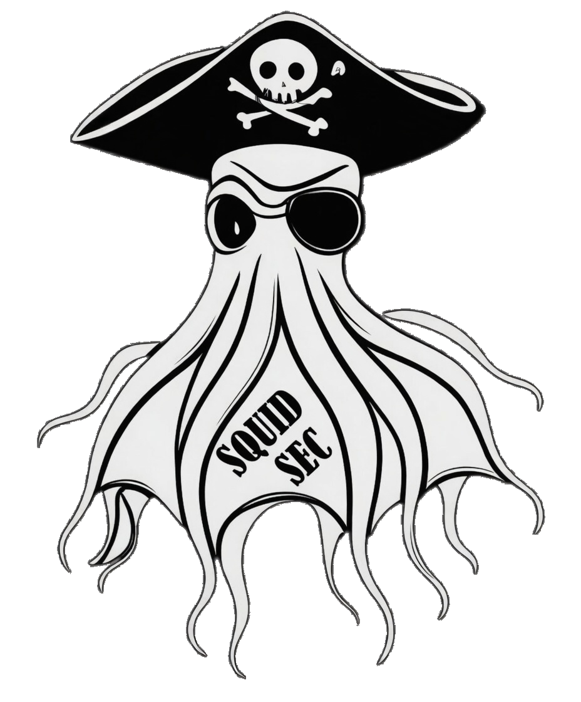

# SquidSec AI Bridge

<p align="center">
  <a href="https://squidoffense.com/">
    
  </a>
</p>

<p align="center">
  <strong>A SquidSec Open Source Project</strong><br>
  <a href="https://squidoffense.com/">SquidOffense.com</a> ·
  <a href="https://github.com/SquidSec/SquidSec_BurpAIBridge">GitHub</a>
</p>

<p align="center">
  <a href="https://github.com/SquidSec/SquidSec_BurpAIBridge/actions/workflows/run-tests.yml"></a>
  <a href="https://github.com/SquidSec/SquidSec_BurpAIBridge/actions/workflows/release-jar.yml"></a>
  <a href="https://github.com/SquidSec/SquidSec_BurpAIBridge/releases/latest"></a>
  <a href="LICENSE"></a>
  <a href="https://portswigger.net/burp"></a>
</p>

Burp Suite extension that exposes a **loopback MCP and JSON HTTP API** so an authorized LLM agent can use the live Burp project.

Built and maintained by **[SquidSec](https://squidoffense.com/)**.

| | |
|--|--|
| **Organization** | [SquidSec](https://squidoffense.com/) |
| **Website** | [https://squidoffense.com/](https://squidoffense.com/) |
| **Version** | **2.0.0** |
| **License** | [Apache 2.0](LICENSE) |
| **Build** | JDK 17+ |

Default bind: `http://127.0.0.1:9877`. Token is generated on first load. Copy it from the **AI Bridge** suite tab.

Scanner and Collaborator need Burp Suite Professional. They fail cleanly on Community Edition.

This extension does **not** call an LLM. It does not use Burp AI or third-party AI APIs. Agents connect to the local API themselves.

## About SquidSec

SquidSec is a U.S. veteran-owned cybersecurity company. We build tools for authorized pentesting and red team work.

- **Website:** [https://squidoffense.com/](https://squidoffense.com/)
- **This project:** [https://github.com/SquidSec/SquidSec_BurpAIBridge](https://github.com/SquidSec/SquidSec_BurpAIBridge)

## What it does

- MCP tool discovery: `GET /mcp/tools` and JSON-RPC `POST /mcp`
- Scope check / include / exclude
- Proxy history, intercept, WebSocket history
- Match/replace rewrite rules
- Send to Repeater, Intruder, Organizer, Comparer, Decoder
- HTTP send through Burp (optional via the proxy listener so it lands in Proxy History)
- Sitemap, cookies, annotations, search
- Scanner crawl / audit / issues / report (Pro)
- Collaborator payload + poll (Pro)
- Engagement helpers: curl, finding draft, endpoint map, CSRF PoC, decode, program-JSON scope, evidence pack

## Build

```bash
./gradlew test jar
```

Output: `build/libs/burp-ai-bridge-2.0.0.jar`

## Install in Burp

1. Extensions → Installed → Add
2. Type: Java
3. Select the JAR
4. Open the **AI Bridge** tab and copy the token / LLM connection info
5. Health check (no auth): `GET http://127.0.0.1:9877/health`

Keep listen host on `127.0.0.1` unless you need WSL. Do not expose the listener to untrusted networks.

## MCP

```bash
curl -sS http://127.0.0.1:9877/mcp/tools
curl -sS -H "Content-Type: application/json" \
  -d '{"jsonrpc":"2.0","id":1,"method":"tools/list"}' \
  http://127.0.0.1:9877/mcp
curl -sS -H "Authorization: Bearer YOUR_TOKEN" \
  -H "Content-Type: application/json" \
  -d '{"name":"burp_bridge_health","arguments":{}}' \
  http://127.0.0.1:9877/mcp/call
```

Turn Proxy intercept **off** before automated `/http/send` or the call will hang.

## Security

- Loopback only by default
- Token required for mutating and reading project data
- No CORS wildcard (browser pages cannot call the API from other origins)
- Treat HTTP message bodies as untrusted
- Finding helpers redact common secret headers
- Use only against systems you are authorized to test

## BApp Store

See `BappManifest.bmf`, `BappDescription.html`, `BAPP_ACCEPTANCE.md`, and `SUBMISSION.md`.

## License

Apache License 2.0. SquidSec — U.S. Veteran-Owned. https://www.SquidOffense.com
